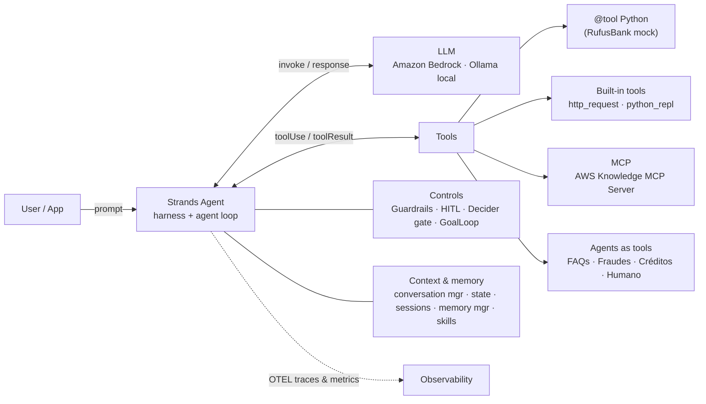
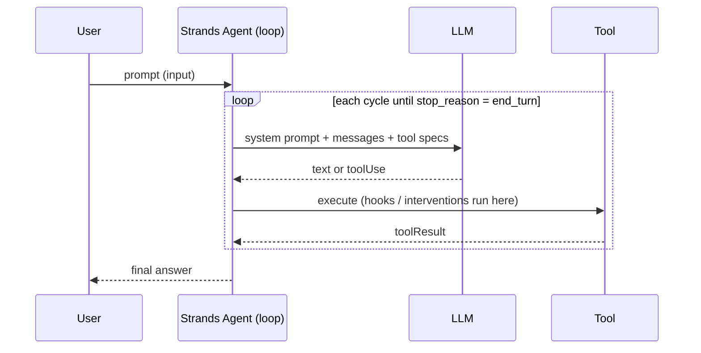

# AWS-STRANDS-AGENTS-DEMO

Hands-on demos and a masterclass deck for **[Strands Agents](https://strandsagents.com/)** (the open source Harness SDK by AWS) on **Amazon Bedrock**, with simple FSI scenarios for a fictional bank called **RufusBank** 🐶.

- **16 simple, runnable Python examples** in [`local/`](local/): from "hello world" to a 100% local model, MCP, memory, guardrails, Strands Decider, skills, agents-as-tools and model routing.
- **Masterclass slides** (standalone HTML, 47 slides, animated): [`2026-10-18-Strands-Agents-Masterclass-Santi.html`](2026-10-18-Strands-Agents-Masterclass-Santi.html). Navigate with `←/→`, `I` for the index, `F` for fullscreen.
  - AI-generated illustrations (OpenAI `gpt-image-2.5-sunburst`), official logos (Kiro, Claude Code, Amazon Quick, OpenCode, Amazon Bedrock AgentCore, Amazon Quick Suite, AWS DevOps Agent), a repo QR code and timeline animations (agent loop, context window filling up, F1 pit-stop hooks, chaos → JSON, memory types, guardrails lanes, LLM vs Decider, supervisor + specialists).

Versions validated on 2026-10-18: `strands-agents 1.61.1` (`[otel, ollama]` extras), `strands-decider 0.1.0`, Ollama `0.15.4` + `gemma3:270m`. Bedrock models (us-east-1): Claude Opus / Sonnet / Haiku 5.5, Amazon Nova 2 Lite, Llama 4 Maverick, DeepSeek V3.2, Kimi K3.

## Architecture





## Setup

```bash
poetry config virtualenvs.in-project true --local
poetry install --no-root          # creates ./.venv
aws login                          # AWS credentials with Amazon Bedrock model access (us-east-1)
poetry run python local/ex_01_hello_world.py
```

Local model (ex_03, no cloud, no API key):

```bash
brew install ollama        # or https://ollama.com/download
ollama serve               # or: brew services start ollama  -> http://localhost:11434
ollama pull gemma3:270m    # smallest Gemma: 270M params, ~290 MB
```

Strands Decider server (ex_13, isolated env, ~4 GB first download):

```bash
uvx --python 3.13 --from strands-decider strands-decider serve \
    StrandsAgents/strands-decider-2B-qwen3.5-v1-2610 --port 8099 --device mps   # mps | cpu | cuda
```

Env overrides: `GUARDRAIL_ID` / `GUARDRAIL_VERSION` (ex_11), `SHOW_SPANS=1` (ex_08), `STRANDS_DECIDER_URL` (ex_13).

Bonus: the **Strands Agents MCP server** helps any coding agent (Kiro, Claude Code, Amazon Quick, OpenCode...) write Strands agents with up-to-date docs:

```json
{ "mcpServers": { "strands-agents": { "command": "uvx", "args": ["strands-agents-mcp-server"] } } }
```

## Examples (mapped to the masterclass slides)

| # | File | Concept | Slide |
|---|------|---------|-------|
| 01 | `ex_01_hello_world.py` | `from strands import Agent` + `Agent(...)("...")` | 20 |
| 02 | `ex_02_bedrock_models.py` | `BedrockModel`: Claude, Nova, Llama, DeepSeek, Kimi | 21 |
| 03 | `ex_03_local_model_ollama.py` | `OllamaModel` + Gemma 3 270M, 100% local | 22 |
| 04 | `ex_04_custom_tools.py` | `@tool`, Spanish docstrings, RufusBank mock data | 23 |
| 05 | `ex_05_builtin_tools.py` | Built-in tools: `http_request` + `python_repl` | 24 |
| 06 | `ex_06_mcp_aws_knowledge.py` | Remote MCP (`MCPClient(url=...)`), AWS Knowledge MCP Server | 25 |
| 07 | `ex_07_structured_output.py` | Pydantic `structured_output_model` (Rick Sanchez loan) | 26 |
| 08 | `ex_08_streaming_observability.py` | `stream_async`, OTEL, metrics summary | 13, 27 |
| 09 | `ex_09_memory_state_sessions.py` | Conversation manager, agent state, sessions, `MemoryManager` | 15, 28 |
| 10 | `ex_10_hooks_plugins.py` | Hooks + `Plugin` "pit stops", PII masking | 29 |
| 11 | `ex_11_guardrails.py` | Bedrock Guardrails: OK / prompt injection blocked / PII masked | 31 |
| 12 | `ex_12_human_in_the_loop.py` | `HumanInTheLoop`, interrupt / resume | 32 |
| 13 | `ex_13_strands_decider.py` | Strands Decider: triage + tool-call gate | 33, 34 |
| 14 | `ex_14_skills_goal_loop.py` | `AgentSkills` (SKILL.md) + `GoalLoop` | 35 |
| 15 | `ex_15_agents_as_tools.py` | Supervisor + 4 specialists (`agent.as_tool()`) | 36, 37 |
| 16 | `ex_16_model_router.py` | `ModelRouter`: Claude Haiku / Sonnet / Opus | 38 |

Slides 39 (advanced concepts), 43 (Evals) and 44 (Strands Harness) show reference snippets; production deployment with Amazon Bedrock AgentCore is the topic of the next classes.

## Repository structure

```
.
├── 2026-10-18-Strands-Agents-Masterclass-Santi.html   # standalone animated slides
├── local/                    # runnable Strands examples (ex_01 … ex_16)
│   └── skills/               # SKILL.md packages (kyc-onboarding, fraud-triage)
├── agentcore-demo/  backend/  cdk/  lambda-layers/   # AWS deployment demos (CDK)
└── pyproject.toml            # Poetry (.venv at repo root)
```

## Security notes

- All data is synthetic (RufusBank is fictional). `python_repl` runs on the local host by default; use a real sandbox in production.
- The Strands Decider server and Ollama have no authentication: local experiments only.
- APIs must be exposed through API Gateway + Lambda (no public Lambda Function URLs), buckets private, CloudFront in front of S3.

# LICENSE

Copyright 2026 Santiago Garcia Arango
