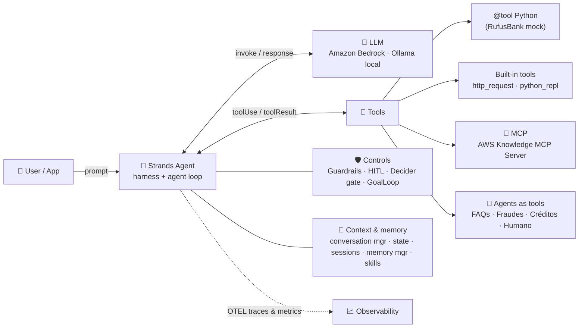
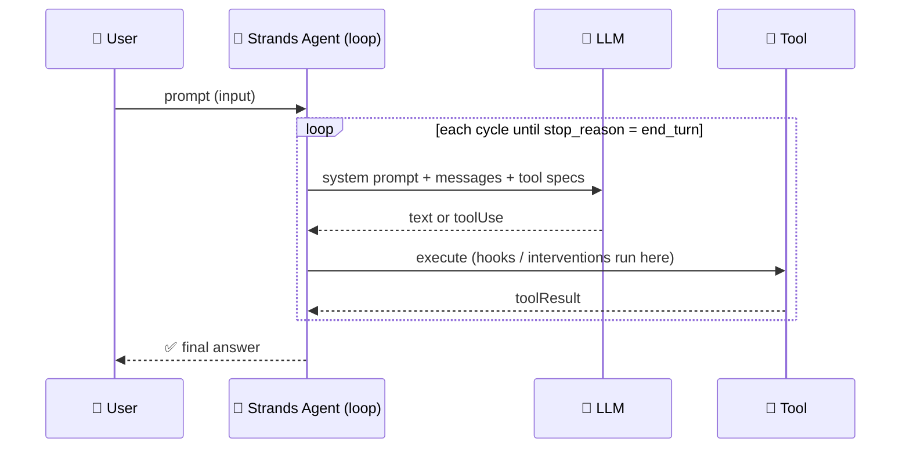

# 🧬 AWS-STRANDS-AGENTS-DEMO


🚀 Hands-on demos and a masterclass deck for **[Strands Agents](https://strandsagents.com/)** (the open source Harness SDK by AWS) on **Amazon Bedrock**, with simple FSI scenarios for a fictional bank called **RufusBank** 🐶🏦.

| 📦 What | 📍 Where | 💡 Notes |
|---|---|---|
| 🐍 **16 runnable Python examples** | [`local/`](local/) | From "hello world" to a 100% local model, MCP, memory, guardrails, Strands Decider, skills, agents-as-tools and model routing |
| 🎤 **Masterclass slides** (47, animated) | [`2026-10-18-Strands-Agents-Masterclass-Santi.html`](2026-10-18-Strands-Agents-Masterclass-Santi.html) | Standalone HTML: open it in any browser, no internet needed |
| 📄 **Validated run report (PDF)** | [`output/2026-10-18-Strands-Agents-Examples-Report.pdf`](output/2026-10-18-Strands-Agents-Examples-Report.pdf) | Every example with how to run it, input, **real output** and validation: read it without running anything |
| 🖼️ **Images used in the deck** | [`assets/images/`](assets/images/) | AI-generated with OpenAI `gpt-image-2.5-sunburst` |

✅ **Validated on 2026-10-18:** `strands-agents 1.61.1` (`[otel, ollama]` extras) · `strands-decider 0.1.0` · Ollama `0.15.4` + `gemma3:270m`.
🧠 **Bedrock models (us-east-1):** Claude Opus / Sonnet / Haiku 5.5 · OpenAI GPT-6 Luna / GPT-5.6 Terra / GPT-6.1 Sol · Llama 4 Maverick · DeepSeek V3.2 · Kimi K3.

---

## 🏗️ Architecture





---

## ⚡ Quick start (5 minutes)

**1️⃣ Prerequisites**
- 🐍 Python 3.11–3.14 and [Poetry](https://python-poetry.org/)
- ☁️ An AWS account with **Amazon Bedrock** model access enabled in `us-east-1`
- 🔑 Active AWS credentials (`aws login`, `AWS_PROFILE`, or `AWS_ACCESS_KEY_ID` + `AWS_SECRET_ACCESS_KEY`)

**2️⃣ Clone and install**

```bash
git clone https://github.com/san99tiago/aws-strands-agents-demo
cd aws-strands-agents-demo
poetry config virtualenvs.in-project true --local
poetry install --no-root          # creates ./.venv
```

**3️⃣ Log in to AWS and run your first agent** 🎉

```bash
aws login
poetry run python local/ex_01_hello_world.py
```

**4️⃣ (Optional) 💻 100% local model for `ex_03`**: no cloud, no API key

```bash
brew install ollama        # or https://ollama.com/download
ollama serve               # or: brew services start ollama  -> http://localhost:11434
ollama pull gemma3:270m    # smallest Gemma: 270M params, ~290 MB
```

**5️⃣ (Optional) ⚡ Strands Decider server for `ex_13`**: isolated env, ~4 GB on first download

```bash
uvx --python 3.13 --from strands-decider strands-decider serve \
    StrandsAgents/strands-decider-2B-qwen3.5-v1-2610 --port 8099 --device mps   # mps | cpu | cuda
```

**6️⃣ 🎤 Open the slides**: double-click the HTML, or run `open 2026-10-18-Strands-Agents-Masterclass-Santi.html`

| ⌨️ Key | Action |
|---|---|
| `→` / `←` / click / swipe | Next / previous slide |
| `I` or `O` | Slide index |
| `F` | Fullscreen |
| `Home` / `End` | First / last slide |

🎛️ **Env overrides:** `GUARDRAIL_ID` / `GUARDRAIL_VERSION` (ex_11) · `SHOW_SPANS=1` (ex_08) · `STRANDS_DECIDER_URL` (ex_13) · `PROVIDER=openai` (ex_16).

---

## 🧪 Examples (mapped to the masterclass slides)


| # | 📄 File | 💡 Concept | 🎤 Slide |
|---|------|---------|-------|
| 01 | 👋 `ex_01_hello_world.py` | `from strands import Agent` + `Agent(...)("...")` | 20 |
| 02 | ☁️ `ex_02_bedrock_models.py` | `BedrockModel`: Claude, OpenAI GPT-5.6 Terra, Llama, DeepSeek, Kimi | 21 |
| 03 | 💻 `ex_03_local_model_ollama.py` | `OllamaModel` + Gemma 3 270M, 100% local | 22 |
| 04 | 🔧 `ex_04_custom_tools.py` | `@tool`, Spanish docstrings, RufusBank mock data | 23 |
| 05 | 🧰 `ex_05_builtin_tools.py` | Built-in tools: `http_request` + `python_repl` | 24 |
| 06 | 🔌 `ex_06_mcp_aws_knowledge.py` | Remote MCP (`MCPClient(url=...)`), AWS Knowledge MCP Server | 25 |
| 07 | 🧾 `ex_07_structured_output.py` | Pydantic `structured_output_model` (Rick Sanchez loan) | 26 |
| 08 | 📡 `ex_08_streaming_observability.py` | `stream_async`, OTEL, metrics summary | 13, 27 |
| 09 | 💾 `ex_09_memory_state_sessions.py` | Conversation manager, agent state, sessions, `MemoryManager` | 15, 28 |
| 10 | 🏎️ `ex_10_hooks_plugins.py` | Hooks + `Plugin` "pit stops", PII masking | 29 |
| 11 | 🛡️ `ex_11_guardrails.py` | Bedrock Guardrails: OK / prompt injection blocked / PII masked | 31 |
| 12 | 🙋 `ex_12_human_in_the_loop.py` | `HumanInTheLoop`, interrupt / resume (answer `y`/`n` in the console) | 32 |
| 13 | ⚡ `ex_13_strands_decider.py` | Strands Decider: triage + tool-call gate | 33, 34 |
| 14 | 📚 `ex_14_skills_goal_loop.py` | `AgentSkills` (SKILL.md) + `GoalLoop` | 35 |
| 15 | 🤝 `ex_15_agents_as_tools.py` | Claude Haiku supervisor + 4 specialists (`agent.as_tool()`) | 37 |
| 16 | 🔀 `ex_16_model_router.py` | `ModelRouter`: Haiku/Luna · Sonnet/Terra · Opus/Sol (`PROVIDER=openai`) | 38 |

▶️ Run any example with `poetry run python local/ex_XX_<name>.py`.
📝 Slides 39 (advanced concepts), 43 (Evals) and 44 (Strands Harness) show reference snippets. Production deployment with **Amazon Bedrock AgentCore** is the topic of the next classes.

---

## 🤖 Bonus: let your coding agent build Strands agents


Add the official **Strands Agents MCP server** to Kiro, Claude Code, Amazon Quick, OpenCode or any MCP-compatible agent. It searches the official Strands docs (`search_docs`, `fetch_doc`), so the code it writes stays up to date:

```json
{
  "mcpServers": {
    "strands-agents": {
      "command": "uvx",
      "args": ["strands-agents-mcp-server"],
      "env": { "FASTMCP_LOG_LEVEL": "INFO" }
    }
  }
}
```

💬 Then just ask: *"Create a Strands agent for RufusBank with guardrails and the AWS Knowledge MCP server."*

---

## 🗂️ Repository structure

```
.
├── 2026-10-18-Strands-Agents-Masterclass-Santi.html   # 🎤 standalone animated slides
├── assets/images/            # 🖼️ AI-generated images used in the deck
├── output/                   # 📄 PDF report: every example with real input/output
├── local/                    # 🐍 runnable Strands examples (ex_01 … ex_16)
│   └── skills/               # 📚 SKILL.md packages (kyc-onboarding, fraud-triage)
├── agentcore-demo/  backend/  cdk/  lambda-layers/   # ☁️ AWS deployment demos (CDK)
└── pyproject.toml            # 📦 Poetry (.venv at repo root)
```

---

## 🔐 Security notes

- 🧪 All data is synthetic: RufusBank is fictional. `python_repl` runs on the local host by default, so use a real sandbox in production.
- 🚫 The Strands Decider server and Ollama have no authentication: local experiments only.
- 🌐 Expose APIs through API Gateway + Lambda (no public Lambda Function URLs), keep buckets private and put CloudFront in front of S3.
- 🔑 Never commit secrets: `.env` is gitignored.

---

💪 **Nunca pares de aprender AWS, vamos con toda!** 🇨🇴

# LICENSE

Copyright 2026 Santiago Garcia Arango
