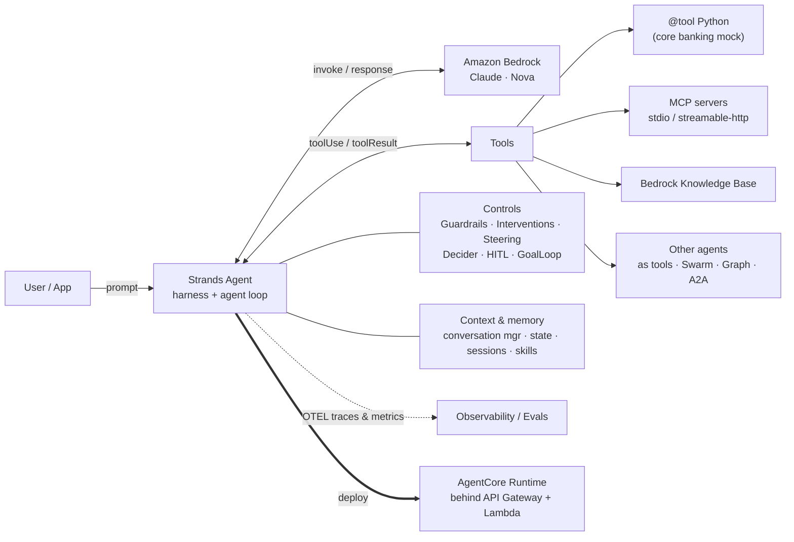
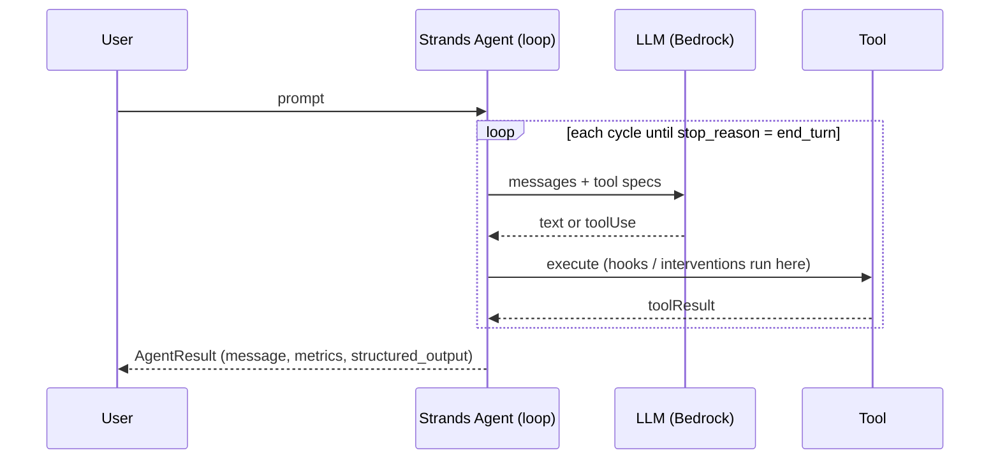

# AWS-STRANDS-AGENTS-DEMO

Hands-on demos and a masterclass deck for **[Strands Agents](https://strandsagents.com/)** (the open source Harness SDK by AWS) on **Amazon Bedrock**, with simple, generic FSI scenarios (a fictional bank called *AnyBank*).

- 29 runnable Python examples in [`local/`](local/), from "hello world" to multi-agent, interventions, Strands Decider, Strands Harness and AgentCore Runtime.
- Masterclass slides (standalone HTML, 45 slides, animated): [`2026-10-18-Strands-Agents-Masterclass-Santi.html`](2026-10-18-Strands-Agents-Masterclass-Santi.html). Navigate with `←/→`, `I` for the index, `F` for fullscreen.
  - Includes 8 AI-generated illustrations (OpenAI `gpt-image-2.5-sunburst`), embedded as compressed JPEG data URIs, plus animated SVG diagrams (agent loop, F1 anatomy, autonomy levels, multi-agent patterns).

Versions validated on 2026-10-17: `strands-agents 1.61.1`, `strands-agents-tools 0.8.9`, `strands-agents-evals 1.6.0`, `strands-harness 0.3.1`, `strands-decider 0.1.0`, `bedrock-agentcore 1.24.1`. Models: `us.anthropic.claude-sonnet-5-5`, `us.anthropic.claude-haiku-5-5`, `us.amazon.nova-2-lite-v1:0`.

## Architecture





## Setup

```bash
poetry config virtualenvs.in-project true --local
poetry install --no-root          # creates ./.venv
export AWS_REGION=us-east-1        # AWS credentials with Bedrock model access
poetry run python local/ex_00_hello_world.py
```

Optional:
- `uvx` (from [uv](https://docs.astral.sh/uv/)) for `ex_05` (AWS Documentation MCP server).
- Strands Decider server for `ex_27` (isolated env, ~4 GB first download):
  ```bash
  uvx --python 3.13 --from strands-decider strands-decider serve \
      StrandsAgents/strands-decider-2B-qwen3.5-v1-2610 --port 8099 --device mps
  ```
- Env overrides: `GUARDRAIL_ID`, `GUARDRAIL_VERSION` (ex_07), `ANYBANK_API_URL` (ex_08), `KB_ID` (ex_10), `OTEL_EXPORTER_OTLP_ENDPOINT` / `SHOW_SPANS` (ex_09), `STRANDS_DECIDER_URL` (ex_27).

## Examples (mapped to the masterclass slides)

| # | File | Concept | Slide |
|---|------|---------|-------|
| 00 | `ex_00_hello_world.py` | First agent, defaults, AgentResult | 22 |
| 01 | `ex_01_select_model.py` | BedrockModel, Sonnet vs Haiku vs Nova (latency/tokens) | 23 |
| 02 | `ex_02_single_default_tool.py` | Built-in `http_request` (vended tools) | 25 |
| 03 | `ex_03_multiple_default_tools.py` | Tool chaining, `python_repl`, `ContextInjector` | 15, 25 |
| 04 | `ex_04_custom_tool.py` | `@tool`, docstrings, `ToolContext`, agent state | 24 |
| 05 | `ex_05_mcp_local_generic.py` | `MCPClient.load_servers` (mcp.json), managed lifecycle | 26 |
| 06 | `ex_06_mcp_local_custom.py` | Custom FastMCP server (`mcp_server_anybank.py`), chat loop | 26 |
| 07 | `ex_07_guardrails.py` | Bedrock Guardrails + input/output redaction | 33 |
| 08 | `ex_08_apis.py` | Wrapping REST APIs (API Gateway) as tools | 24 |
| 09 | `ex_09_observability_otel.py` | StrandsTelemetry, OTLP, trace attributes, metrics | 28 |
| 10 | `ex_10_knowledge_base.py` | Agentic RAG with Bedrock Knowledge Bases | 29 |
| 11 | `ex_11_agent_loop_streaming.py` | Agent loop cycles via `stream_async` | 12, 13 |
| 12 | `ex_12_structured_output.py` | Pydantic `structured_output_model` | 27 |
| 13 | `ex_13_memory_state_sessions.py` | Conversation manager, state, FileSessionManager | 29 |
| 14 | `ex_14_hooks_plugins.py` | Hooks, `Plugin` + `@hook`, PII masking, audit | 30 |
| 15 | `ex_15_interventions_decider.py` | Interventions: Proceed / Deny / Guide / Transform | 32 |
| 16 | `ex_16_human_in_the_loop.py` | `HumanInTheLoop`, interrupt / resume | 34 |
| 17 | `ex_17_steering.py` | `LLMSteeringHandler` (LLM judge on tool calls) | 36 |
| 18 | `ex_18_goal_loop.py` | `GoalLoop` iterative refinement against a goal | 36 |
| 19 | `ex_19_agent_skills.py` | `AgentSkills` + `local/skills/*/SKILL.md` | 36 |
| 20 | `ex_20_agents_as_tools.py` | Supervisor + specialists (`agent.as_tool()`) | 37 |
| 21 | `ex_21_swarm.py` | Swarm hand-offs | 37, 38 |
| 22 | `ex_22_graph.py` | GraphBuilder with conditional edges | 37, 38 |
| 23 | `ex_23_a2a.py` | `A2AServer` + `A2AAgent` | 17, 37 |
| 24 | `ex_24_model_router.py` | `ModelRouter` + `ClassifierStrategy` | 39 |
| 25 | `ex_25_evals.py` | Strands Evals: Case, Experiment, OutputEvaluator | 41 |
| 26 | `ex_26_agentcore_runtime.py` | `BedrockAgentCoreApp` entrypoint (local :8080) | 43 |
| 27 | `ex_27_strands_decider.py` | Strands Decider: triage + tool-call gate | 35 |
| 28 | `ex_28_strands_harness.py` | `create_harness` with least-privilege built-ins | 42 |

Legacy helpers kept as-is: `local/main.py` (old name-generator MCP server), `local/throttle_bedrock.py`, `local/adl_menu_agent.py` (empty).

## Repository structure

```
.
├── 2026-10-18-Strands-Agents-Masterclass-Santi.html   # standalone animated slides
├── local/                    # runnable Strands examples (ex_00 … ex_28)
│   ├── mcp_server_anybank.py # FastMCP stdio server used by ex_06
│   ├── skills/               # SKILL.md packages (kyc-onboarding, fraud-triage)
│   └── data/                 # synthetic transactions for ex_28
├── agentcore-demo/  backend/  cdk/  lambda-layers/   # AWS deployment demos (CDK)
└── pyproject.toml            # Poetry (.venv at repo root)
```

## Security notes

- All data is synthetic. `python_repl`, `shell` and the harness built-ins run on the local host by default; use a real sandbox in production.
- The Strands Decider server has no authentication: local experiments only.
- APIs must be exposed through API Gateway + Lambda (no public Lambda Function URLs), buckets private, CloudFront in front of S3.

# LICENSE

Copyright 2026 Santiago Garcia Arango
